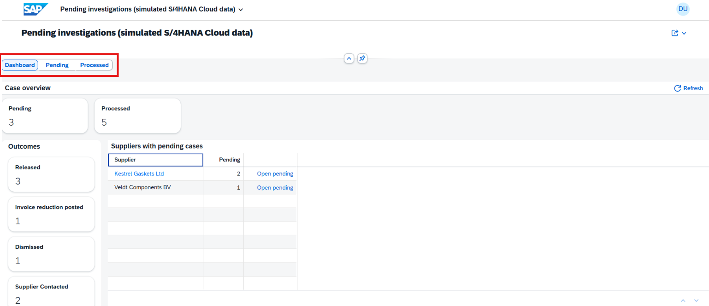
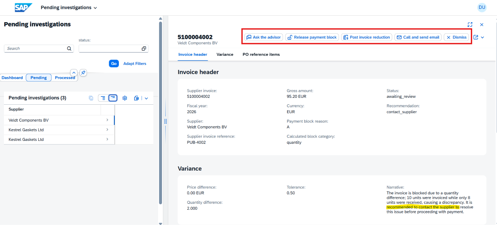
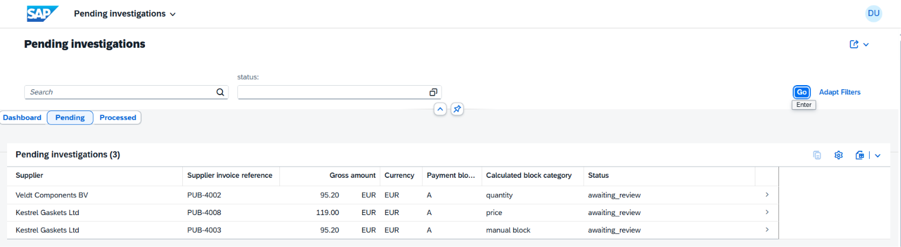
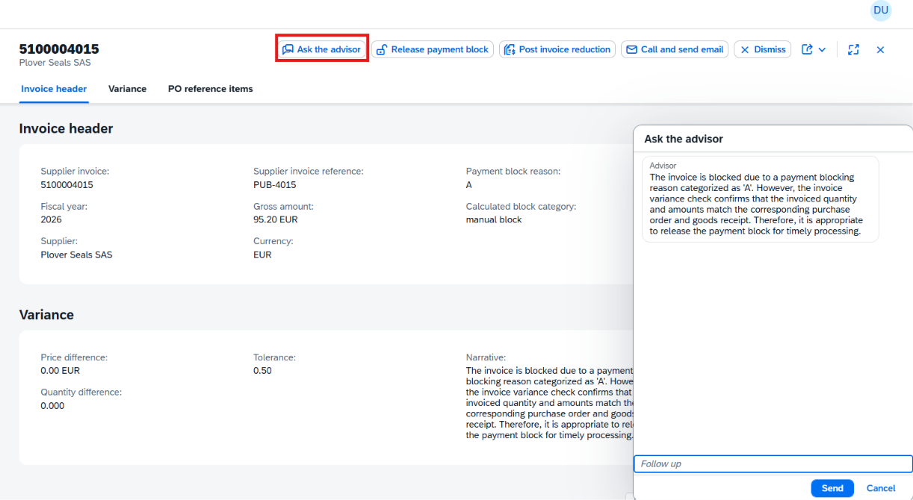
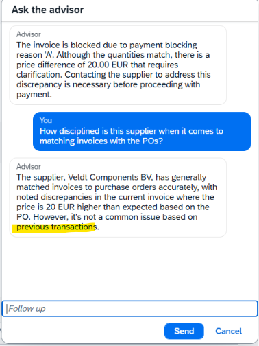

# SAP AI invoice analyzer

## Run

Node.js 26.13.0.

```powershell
npm install
npm start
```

Open the publisher at [http://localhost:4004/publisher](http://localhost:4004/publisher) and send a sample invoice. Open the workbench at [http://localhost:4004/workbench-ui](http://localhost:4004/workbench-ui).

Leave the API key empty and the advisor follows a fixed policy. To use a model, copy `.cdsrc-private.json.example` to `.cdsrc-private.json` and set `apiKey`. Model name, base URL, and price tolerance are in `.cdsrc.json`.

## Screenshots










