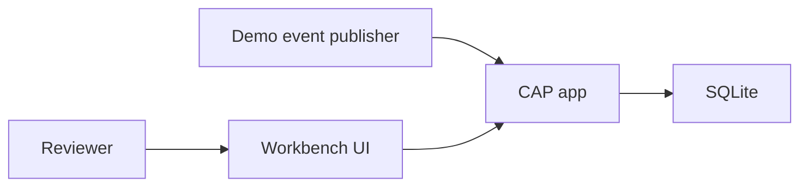

# Solution overview

A local workbench for a blocked supplier invoice. A supplier invoice created event names the invoice. The application reads that invoice, opens an investigation when it is blocked, an agent reads simulated SAP APIs, and a person approves any financial change. The running system is not connected to SAP S/4HANA.

The SAP contracts, and the places they were corrected, are in [sap-reference.md](sap-reference.md). Decisions are in `docs/adr/`.

## Business scenario

A direct-material purchase has a purchase order, a goods receipt (material document, movement type 101), and a posted supplier invoice. The invoice carries `PaymentBlockingReason`, so it should not be paid until someone reviews it.

The workbench:

1. Accepts the event and ignores duplicates.
2. Opens one investigation for that invoice and fiscal year.
3. Calls the advisor module, which chooses read-only tools. The workbench checks the recommendation against a deterministic variance.
4. Shows the invoice, the evidence, and the recommendation.
5. Performs one approved action: release the logistics payment block, post a subsequent credit for a price difference, save a supplier email draft, or dismiss the case.

Three seeded invoices show three different recommendations: subsequent credit, contact the supplier, and release the block.

## System context

The publisher is a script or a button that POSTs the CloudEvent onto the simulated Event Mesh topic. The advisor is a module inside the CAP app. It never talks to a browser and never writes financial documents.

## Components

| Component | Responsibility |
| --- | --- |
| CAP Node.js app, TypeScript handlers | CDS model, SQLite, simulated SAP reads, simulated Event Mesh inbox, investigation API, approved writes, static host for the UI in Compose |
| SQLite file | Simulated documents, investigations, inbox. File on a volume so a restart keeps cases. |
| Advisor module, TypeScript and LangGraph.js | Inside the CAP app. Chooses tools the workbench passes in, and returns a recommendation. Does not import the CDS model. Scripted policy when `LLM_API_KEY` is empty. |
| React workbench | Pending list, investigation detail, history and a small dashboard |
| Demo publisher | Sends the three sample events to the simulated topic |

No real Event Mesh broker, no second database, no second process, no retrieval index. The whole demo is sized for two evenings.

## Data flow

1. Seed CSV loads purchase orders, material documents, business partners, and supplier invoices into `sap.sim`.
2. `POST /simulated-events` stores `invc.EventInbox` and returns `202`.
3. The consumer reads the invoice through the simulated supplier invoice API. An empty `PaymentBlockingReason` means the invoice is not blocked. An unknown key is the same outcome. Both reject the inbox row.
4. When `PaymentBlockingReason` is set, the consumer inserts `invc.Investigations` in status `open` and copies that reason onto the case with the other list fields from the read.
5. The investigation handler calls the advisor module with the case id, an objective, the invoice key, and the six tool functions. The invoice document is not passed in.
6. The advisor calls those functions. Each call is logged as evidence when the recommendation is stored.
7. CAP checks the policy in [tool-catalog.md](tool-catalog.md) and sets status `awaiting_review`.
8. The UI reads `InvestigationService`.
9. An action updates `sap.sim` only for release and subsequent credit, then writes `invc.Decisions` and, except for the email draft, closes the case.

## Event flow

Specified in [event-contracts.md](event-contracts.md). `POST /simulated-events` is the simulated Event Mesh topic. The durable step is the inbox insert, which plays the role of the queue. The advisor runs after that commit. The same CloudEvents `id` cannot create a second row. A second id for an invoice that already has an open investigation does not create a second case. Three failures leave the row `failed` for a manual retry.

## Advisor flow

The advisor sees the objective, the invoice key, and the tool functions the workbench passed. It does not receive a pre-built match, and it does not import the invoice CDS model. The scripted policy calls the supplier invoice, then the purchase order and goods receipts when the invoice item references a purchase order, then the variance function, the business partner, and the supplier's other invoices.

A configured OpenAI-compatible chat model may choose the order. The store step on the workbench still requires the invoice read, the variance result when a purchase-order reference exists, and the action rules. Narrative text is the model's. Amounts are the variance function's.

Findings are `fact`, `assumption`, or `missing`. An assumption includes the project tolerance. A missing goods receipt is missing information, and the quantity difference is the full invoiced quantity only when the unit matches and the receipt list is empty. The recommendation then cannot be a release or a subsequent credit.

## Human approval flow

The UI posts one investigation action with an actor name. There is no login in the MVP. The actor is recorded on the decision.

| UI action | Service action | SAP operation simulated | Effect on the original invoice |
| --- | --- | --- | --- |
| Accept / proceed | `releasePaymentBlock` | Release on `API_SUPPLIERINVOICE_PROCESS_SRV` | Clears `PaymentBlockingReason` when the case is a logistics block and the variance rule allows release |
| Request invoice adjustment | `postSubsequentCredit` | Create on the same API, as a subsequent credit | Original row unchanged. New credit document inserted. |
| Contact supplier | `prepareSupplierContact` | None | None. Draft stored on the decision. Case stays `awaiting_review`. |
| Dismiss | `dismissInvestigation` | None | None. Case `closed`, outcome `dismiss`. |

The action handler recomputes variance and refuses a release or a subsequent credit that the policy does not allow, even if the client sends it. A repeated post of a completed decision returns the existing decision.

Accept / proceed does not mean "post the invoice" and does not mean "pay the supplier". The seeded invoices are already posted. Payment execution is out of scope. Finance-only blocks, which KBA 3778193 says this API cannot release, are not seeded. The handler refuses release when the simulated invoice has no `PaymentBlockingReason`.

## Local and real SAP

| Real SAP integration | This demo |
| --- | --- |
| Communication arrangement `SAP_COM_0057`, `SAP_COM_0053`, `SAP_COM_0108`, `SAP_COM_0008`, x509 as labeled on the Hub | No credentials. Adapters read SQLite. |
| OData V2 on `/sap/opu/odata/sap/...` | CAP services `/simulated-s4`, `/agent-tools`, `/workbench` |
| Enterprise Event Enablement and SAP Event Mesh | `POST /simulated-events` and the SQLite inbox, with the same consumer duties: accept a CloudEvent, store it, tolerate a repeat |
| Released event type `sap.s4.beh.supplierinvoice.v1.SupplierInvoice.Created.v1` | Same type on the local topic. The payment block reason comes from the invoice read. |
| Fiori Release Blocked Invoices | Workbench action that simulates the release API |
| Invoice posted in the tenant | Seed data, plus subsequent credits created by the action |

## Technology choices

| Choice | Why |
| --- | --- |
| Node.js and TypeScript | One language for the CAP app, the advisor module, and the UI. |
| CAP on Node.js | Local SQLite path in the CAP docs, CDS services, OData for the UI. Simulated documents are queried here. |
| SAP Cloud SDK | Not a dependency. There is no tenant and no service metadata for it to call. See [ADR 0006](../adr/0006-cap-queries-not-cloud-sdk.md). |
| SQLite file | One file, no server, matches CAP's local guide. In-memory SQLite stays available for unit tests. |
| LangGraph.js inside the advisor module | Tool calling stays out of the invoice handlers. The workbench passes the tools in. |
| React | Custom three-pane workbench. Fiori elements would be the SAP UI technology and would spend the evenings on floorplans instead of the investigation flow. |
| OpenAI-compatible HTTP | `LLM_BASE_URL`, `LLM_API_KEY`, `LLM_MODEL`. Empty key selects the scripted policy. |
| Docker Compose | One app and a SQLite volume |

## Architectural decisions

- [ADR 0001](../adr/0001-target-s4hana-cloud-public-edition.md) Public Edition released APIs.
- [ADR 0002](../adr/0002-local-inbox-instead-of-event-mesh.md) SQLite inbox.
- [ADR 0003](../adr/0003-subsequent-credit-for-price-variance.md) Subsequent credit for a price difference.
- [ADR 0004](../adr/0004-read-only-agent-human-approved-writes.md) Agent reads, people approve writes.
- [ADR 0005](../adr/0005-advisor-module-in-the-cap-app.md) Advisor module in the CAP app.
- [ADR 0006](../adr/0006-cap-queries-not-cloud-sdk.md) CAP queries for simulated documents.

## Corrections to the original brief

| Issue | Why it matters | Evidence | Correction |
| --- | --- | --- | --- |
| "Goods receipt API" as a peer of the invoice API | The posted receipt is a material document. A similarly named confirmation API belongs to Guided Buying purchase requisitions. | Hub titles for `API_MATERIAL_DOCUMENT_SRV` and `SSPOPENITMGOODSRECEIPT_0001` | Tool `get_goods_receipts` reads material documents, movement type 101. |
| Accept / proceed as a generic SAP write | A blocked invoice in this scenario is already posted. Posting it again, or paying it, is a different process. Release fails when the invoice is not in the logistics block set. | KBA 3439469, KBA 3778193, Release Blocked Invoices app | Accept calls the supplier invoice release operation and only clears the payment block. |
| Request adjustment might edit the invoice or always create a credit memo | Posted invoices are not changed in place. A subsequent credit adjusts value and keeps quantity. A credit memo is the quantity-correcting document. | SAP Learning, logistics invoice verification. KBA 3838004 for the item-level subsequent flag. | Price-variance seed posts a subsequent credit. Quantity-variance seed must not. |
| Compare gross amount to the purchase order | `InvoiceGrossAmount` includes tax. | Field is the header gross. Item amount is `SupplierInvoiceItemAmount` in the Help test script. | Variance uses the item amount and the PO net price. |
| An official blocked-invoice event | The Public Edition package `CE_SUPPLIERINVOICEEVENTS` publishes posted and reversed invoices only. | [metadata/CE_SUPPLIERINVOICEEVENTS.asyncapi.json](../../metadata/CE_SUPPLIERINVOICEEVENTS.asyncapi.json) | Handle the created event. A non-empty `PaymentBlockingReason` on the invoice is the block, and that value is the reason on the case. |
| Event Mesh as local infrastructure | The behavior to demonstrate is validation, idempotency, and retry. | CAP can persist the inbox in SQLite. | No broker. |
| Agent receives a context object, or the agent posts the financial document | The brief asked for tool choice and for human approval. One without the other misses the portfolio point. | ADR 0004 | Read tools only. Policy check before save. Writes only on investigation actions. |
| Item blocking reason codes (`SPGRQ` and similar) on the OData payload | Those are classic invoice-verification indicators. They are not properties of `A_SupplierInvoiceType`. `A_SupplierInvoiceBlock` still uses the one-character `PaymentBlockingReason`. | [metadata/API_SUPPLIERINVOICE_PROCESS_SRV.edmx](../../metadata/API_SUPPLIERINVOICE_PROCESS_SRV.edmx) | UI "block reason" shows raw `PaymentBlockingReason` and a calculated block category, labeled as calculated. |
| Supplier invoice history as its own API | History is a filtered read of the same invoice API, and an unfiltered read is unsafe. | KBA 3644600 | `get_supplier_invoice_history` filters on `InvoicingParty`. |
| A real Event Mesh broker on the laptop | The faithful part is the consumer: store the CloudEvent, then ignore a duplicate. | ADR 0002 | Simulated topic and SQLite inbox. |
| Dashboard required for the first demo | It does not change the financial path. | Two evenings | Tickets 001–007 are the vertical slice. Ticket 008 is optional. |

## Schemas on disk

The four OData schemas and the supplier invoice event specification are in [metadata/](../../metadata/). They were downloaded from the sandbox and the signed-in Hub on 2 November 2026. Ticket 003 follows those files. The running app still does not call SAP.
